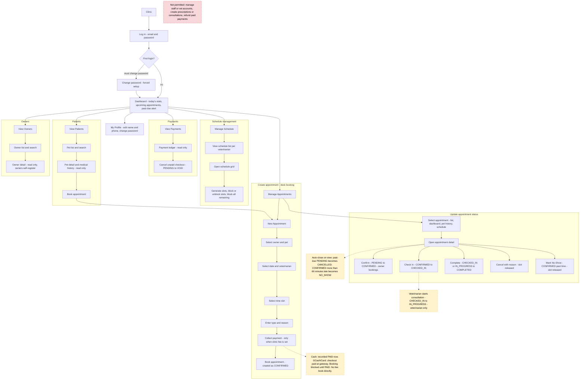
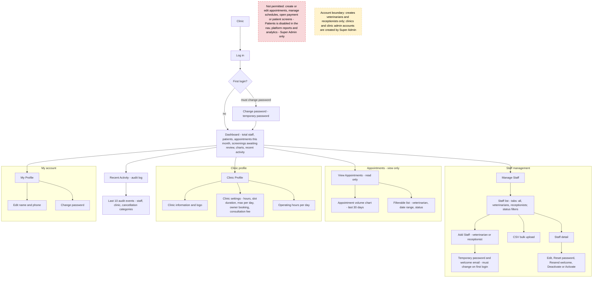

# Program Workflows

Role-based program workflows for XPawSure web application.

These diagrams reflect the implemented code, not the intended design. Source of truth:

- Backend permissions: `backend/core/permissions.py`, per-app `views.py`
- Frontend routes and guards: `frontend/React/src/App.tsx`, `features/auth/components/ProtectedRoute.tsx`
- Appointment transitions: `backend/appointments/services.py` (`VALID_TRANSITIONS`)

Editable draw.io sources:

- `docs/assets/diagrams/receptionist-program-workflow.drawio`
- `docs/assets/diagrams/clinic-admin-program-workflow.drawio`

---

## 1. Receptionist

### 1.1 Corrections applied to the previous diagram

| Previous step | Problem | Correction |
|---|---|---|
| Dashboard → Manage Vet Accounts → Add / Deactivate Veterinarian | Receptionist has no staff permissions. `staff/views.py` and `veterinarians/views.py` are `IsClinicAdmin`; API returns 403. | Removed. Moved to the Clinic Admin workflow. |
| Log in → Dashboard | Missing forced first-login password change. `usr_must_change_password` blocks every write until changed. | Added "First login → Change password" gate before Dashboard. |
| Manage Appointment → Select Appointment → View Schedule → Set Schedule | Selecting an appointment does not lead to schedule setup. Schedule is an independent module (vet list → slot grid → generate/block). | Split into two branches: "Manage Appointments" and "Manage Schedule". |
| Set Vet for Consultation (after Set Schedule) | The veterinarian is chosen at booking time via the selected slot. No re-assign endpoint exists (`stf_id` is written only at creation). | Moved into the booking flow: "Select date and veterinarian → Select time slot". |
| Confirm Payment (after setting the vet) | No staff confirmation action exists. Payment gates booking *before* the appointment is created: cash is `PAID` at checkout creation, GCash/Card settle at the gateway/webhook. | Payment step placed inside the booking flow, before "Book appointment". Added read-only Payments module with `PENDING → VOID` cancel only. |
| Update Appointment Status (single box) | Hides the actual transition rules, roles, and auto-close behavior. | Expanded into the five real actions with exact transitions (§1.3). |

Missing from the previous diagram and now added: Payments, Patients, Owners modules; the veterinarian handoff for starting a consultation; system auto-close behavior.

### 1.2 Workflow

### 1.3 Appointment status transitions owned by the receptionist

`PATCH /api/appointments/{id}/` — receptionist only for mutations (veterinarians receive 403 and must use start/request endpoints; the clinic admin cannot `PATCH` at all, see §3).

| From | Action | To | Notes |
|---|---|---|---|
| PENDING | Confirm | CONFIRMED | Owner mobile bookings only; desk bookings are created `CONFIRMED`. Past-time confirm is rejected. |
| CONFIRMED | Check In | CHECKED_IN | Sets `apt_checked_in_at`. |
| CHECKED_IN / IN_PROGRESS | Complete | COMPLETED | Sets `apt_completed_at`. |
| PENDING / CONFIRMED / CHECKED_IN | Cancel with reason | CANCELLED | Slot released to `AVAILABLE`; owner notified. |
| CONFIRMED (past time) | Mark No-Show | NO_SHOW | Slot released to `AVAILABLE`. |

System auto-close runs whenever the list or dashboard is read: past-due `PENDING → CANCELLED` ("Not confirmed in time"), `CONFIRMED` more than 60 minutes late `→ NO_SHOW`.

Veterinarian handoff: `CHECKED_IN → IN_PROGRESS` happens only through `POST /api/veterinarian/appointments/{id}/start/`, for the assigned veterinarian.

---

## 2. Clinic Admin

### 2.1 Workflow

### 2.2 Notes

- Dashboard data comes from `GET /api/staff/stats/`, `GET /api/appointments/volume/`, `GET /api/screenings/stats/`, and `GET /api/audit-logs/` — all `IsClinicAdmin`.
- Appointment list is read-only: `GET /api/appointments/` allows `CLINIC_ADMIN`, but `POST` returns 403 and the detail view (`GET`/`PATCH`) allows only `RECEPTIONIST`/`VETERINARIAN`. The admin UI has no detail route or status buttons.
- Clinic settings written here gate receptionist booking: consultation fee and "allow owner booking" are read by the booking flow (`GET /api/clinic/settings/` also admits receptionist).
- Staff accounts created here are created with `usr_must_change_password = True`; the new staff member is forced through the change-password screen on first login.

---

## 3. Known documentation discrepancy

`docs/api/API_SPEC.md` (§5, status change endpoint) states that the Clinic Admin may change appointment status. The implemented permission is `HasRole(RECEPTIONIST, VETERINARIAN)` (`backend/appointments/views.py:313`), so the clinic admin receives 403. These workflows follow the code. The API spec should be corrected separately.
